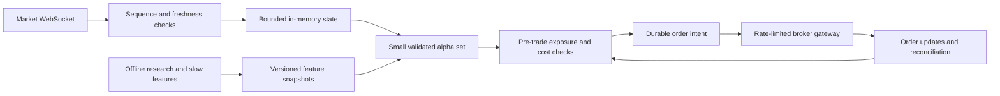

# HFT-style execution review

The useful change is to optimize **measurable net edge and order-state correctness**, then latency. More trades, more indicators and faster submission do not establish profitability. This repository remains a broker-API trading system; no HFT or income readiness is certified.

NSE offers exchange co-location infrastructure for trading members; it is materially different from the current broker API path ([NSE co-location facility](https://www.nseindia.com/static/trade/platform-services-co-location-facility)). SmartAPI documents WebSocket order-status updates and cumulative rate limits across placement, modification and cancellation ([official documentation](https://smartapi.angelone.in/docs)). No request rate was increased by this work.

## Execution controls implemented

- Replacement orders require a confirmed terminal cancellation/rejection/expiry state. A cancellation acknowledgement alone, missing order-book row or still-open order cannot authorize another full-size order.
- Ambiguous submission acknowledgements and unresolved post-cancel states set `reconciliation_required`. The TradeManager caller locks new entries when that flag is set. A partial fill with a live remainder also requires reconciliation; confirmed filled quantity is retained in live-trade metadata.
- Quote-aware pricing and ordinary limit pricing obey the same absolute slippage cap, rounded downward to the tick for BUY entries.
- Missing, nonpositive and nonfinite live LTP values block submission. Signal age is checked again after broker price lookup, immediately before every submission/replacement.
- Router durations use monotonic clocks. Each report measures application-call time for quote lookup, submit-to-ack, fill waiting, cancel-to-ack and reconciliation lookup. These are client-side timings, not exchange timestamps or wire latency; repeated stages accumulate across attempts.
- Execution telemetry requires distinct decision and fill prices to claim slippage evidence. A journal entry price is no longer compared with itself and reported as zero slippage. Invalid or missing fill latency remains unknown. Journal reads are read-only and explicitly closed.
- A COMPLETE status cannot override an explicit zero filled quantity. A missing average fill price is not replaced with the submitted limit and presented as a measured execution; contradictory or incomplete fill data requires reconciliation.

These changes are saved in source. Running services were not restarted, no live order was submitted and no external message was sent by this review.

## Measured evidence

The inspected journal contained **12 paper trades, zero live trades**. Explicit fill-price, fill-latency and entry-slippage coverage were all **0%** under the corrected measurement rules. Average measured slippage and fill latency are unknown, rather than zero. The telemetry database contained **zero scan-cycle and zero strategy-run timing records**. There is no measured p50/p95/p99 live latency or live implementation-shortfall distribution to optimize against yet.

Snapshots: [reports/hft_execution_review_2026-10-14](reports/hft_execution_review_2026-10-14/).

## Architecture to work toward

Remaining work is concrete:

1. **Durable order ownership:** write order intent before submission; reconcile outstanding intents and positions at startup; retain unresolved-state blocks across process restarts and daily resets. The new entry lock is an in-process control, and the existing daily reset can clear it. The audit log is not a transactional order-management ledger. Do not treat this patch as a complete crash-safe OMS.
2. **Bound market-data age:** retain exchange time, local receive time and processing time separately; reject sequence regressions, detect gaps, and bound queue backlog. Current LTP calls do not establish the freshness of an executable bid/ask quote.
3. **Remove blocking enrichment:** macro/news fetches and expensive model work must publish cached, versioned features from workers. The current signal path can still call remote enrichment. Avoid adding synchronous SQLite writes to every tick merely to collect telemetry.
4. **Measure before optimizing:** collect stage latency and quote age, then report p50/p95/p99 separately for paper and live. Select a processing deadline from measured signal decay, not an arbitrary advertised microsecond target. Router instrumentation only becomes available to running services after deployment.
5. **Validate microstructure economics:** use executable spreads, actual fees and taxes, partial fills, queue position and adverse price movement after fills. Replay recorded events deterministically before changing execution policy. Tick-direction imbalance is not proof of order-book or aggressor-flow edge.
6. **Keep risk independent of alpha:** bound position exposure, order count, pending notional and cancellation activity across processes; reconcile before resuming after ambiguity. Existing kill switches and shared broker pacing must remain effective even if a strategy requests more trades.

The research objective is expected gross edge minus fees, spread, slippage, adverse selection and funding costs, subject to risk limits. None of the present strategy results establishes a dependable ₹30,000 monthly withdrawal from ₹500,000. HFT-style engineering does not change that evidence requirement.

## Verification

Final focused router, telemetry, execution-economics, disconnect and catalogue checks: **78 passed**. This includes duplicate-prevention, partial/open remainder, missing state, submission timeout, invalid quote, post-lookup expiry, price-cap, monotonic timing and unverified-fill cases.

A wall-clock-dependent catalogue test exposed by the first broad run was fixed to use an explicit trading timestamp. The subsequent broad regression passed **1,148 tests** with 12 warnings. The final focused run above also covers two fill-evidence cases added after that broad run began. Logs are recorded alongside the evidence snapshots. Static checks and changed-file whitespace checks passed.
